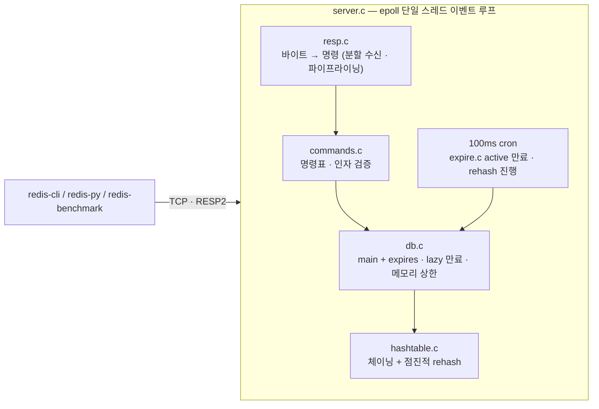

# Mini Redis

> **Krafton Jungle WEEK11-12 · Team 11** — [mini-react](https://github.com/cc8s/jungle-team11-mini-react) · [mini-redis](https://github.com/cc8s/jungle-team11-mini-redis) · [mini-dbms](https://github.com/cc8s/jungle-team11-mini-dbms) · [보드](https://github.com/users/cc8s/projects/9)

해시 테이블부터 직접 만든 **RESP 호환 인메모리 키-값 저장소** (C11, epoll).
우리가 만들지 않은 클라이언트 — `redis-cli`, `redis-py`, `redis-benchmark` — 가 그대로 접속한다.

- **진짜 Redis 와 응답 바이트 비교 2129건 일치** (차등 테스트, CI 에서 Redis 8.10 기준)
- 같은 기계에서 SET/GET 처리량 약 15만 req/s — 진짜 Redis 8 과 비슷 (작은 값, 영속성 끔)
- 느린 API(100ms) 앞에 캐시로 두면 처리량 **7.8배**, p50 지연 102ms → 13ms

## 실행 방법

> epoll 을 쓰므로 **Linux 전용**이다(WSL·devcontainer 가능).

```bash
make && ./mini-redis --port 6379        # 서버
redis-cli -p 6379 SET name cc8s EX 60    # 다른 터미널에서
make test itest difftest demotest        # 단위 · 통합 · 진짜 Redis 와 비교 · 데모 기능 테스트
```

옵션: `--maxmemory 100mb --maxmemory-policy noeviction|allkeys-random`

## 아키텍처



**네트워크를 모르는 모듈을 최대한 크게** 만들었다. 소켓을 다루는 건 `server.c` 하나뿐이다. `cmd_execute(db, argv, out)` 는 명령을 받아 응답 바이트를 쓰는 함수라서, 서버를 띄우지 않고도 명령 동작 전체를 테스트한다.

## 핵심 로직

### 1. 해시 테이블 — 체이닝 + 점진적 rehash

```
hash("name") % 8 = 5  →  buckets[5] 로 바로 이동 (O(1))
충돌은 체이닝:  buckets[3] → ["name"] → ["age"] → NULL
```

- 키 수 ≥ 버킷 수(부하율 1)면 2배로 키운다. 버킷 수가 바뀌면 모든 키 위치를 다시 계산해야 한다(rehash).
- **한 번에 다 옮기면 서버가 멈춘다.** 스레드가 하나라 키 100만 개를 옮기는 동안 모든 클라이언트가 기다린다. 그래서 테이블 두 개(`ht[0]`, `ht[1]`)를 두고 명령 하나마다 버킷 하나씩 옮긴다(+ 100ms cron 에서 1ms 씩).
- **불변식: 옮기는 도중에도 모든 키는 두 테이블 중 정확히 한 곳에만 있다.**

| rehash 도중 | 처리 | 틀리면 |
|---|---|---|
| GET / DEL | `ht[0]` 보고 없으면 `ht[1]` | 못 찾음 |
| 새 키 SET | **항상 `ht[1]`** | 이미 지나간 `ht[0]` 자리에 넣으면 끝난 뒤 **사라짐** (TC-HT-010) |
| 기존 키 SET | 있는 자리에서 값만 교체 | 두 테이블에 중복 (TC-HT-011) |

체이닝을 고른 이유: 삭제가 단순하고(DEL·만료가 잦음, 개방 주소법은 묘비 필요), 부하율이 1을 넘어도 동작해 rehash 도중을 버틴다.

### 2. RESP — 데이터는 `\r\n` 이 아니라 **길이**로 읽는다

```
*3\r\n $3\r\nSET\r\n $4\r\nname\r\n $4\r\ncc8s\r\n      (배열 3개, 각각 길이 + 바이트)
```

- 값 안에 `\r\n`, `\0`, 공백이 있어도 된다(바이너리 안전). `\r\n` 은 머리줄 끝에만 쓴다.
- TCP 는 바이트 흐름이라 명령 경계를 파서가 찾는다. 모자라면 **INCOMPLETE**(아무것도 소비 안 함, 다음 read 를 기다림), 완성되면 쓴 바이트 수를 돌려준다. 서버는 그만큼 잘라 내며 반복한다 → **분할 수신과 파이프라이닝**.
- **메모리 고갈 DoS 방어**: `$999999999999` 처럼 길이만 크게 선언해도, 명령이 다 도착하기 전에는 메모리를 잡지 않는다(검사 → 복사 2단계). 벌크 512MB, 입력 버퍼 1GB 상한.

### 3. 동시성 — 락 0개

명령을 **스레드 하나에서 하나씩 끝까지** 실행한다. epoll 이 "읽을 게 생긴 소켓"만 알려 주므로 수천 연결을 한 스레드가 받는다. 동시에 접속하지만 동시에 실행하지는 않는다 → 경쟁 상태가 구조적으로 없다. 만료 정리·rehash 도 같은 루프의 cron 이라 충돌하지 않는다.

**대가: 느린 일 하나가 모두를 막는다.** 그래서 rehash 는 점진적으로, active 만료는 25ms 상한으로 나눠 한다. 한 클라이언트가 쉬지 않고 쏟아부을 때도 마찬가지라, 이벤트 한 번에 16KB 만 읽고 다음 클라이언트로 넘어간다.

| 쏟아붓는 클라이언트 옆에서 다른 클라이언트의 PING | 최악 지연 |
|---|---|
| 소켓을 `EAGAIN` 까지 계속 읽던 처음 구현 | **763ms** |
| 이벤트당 16KB 한 번 읽기 (Redis 와 같은 방식) | **0.8~1.2ms** (CI 0.3ms) |

### 4. 만료 — lazy + active

| | lazy | active |
|---|---|---|
| 언제 | 그 키를 조회할 때 | 100ms 마다 |
| 하는 일 | 만료 시각이 지났으면 지우고 "없음" | TTL 있는 키 20개 무작위 → 지난 것 삭제, 25% 넘게 지났으면 반복(최대 25ms) |
| 보장 | **만료된 값은 절대 응답하지 않는다** | 아무도 안 찾는 만료 키의 **메모리 회수** |

- 만료 시각은 값과 **별도 테이블**(`expires`)에 둔다. 샘플링이 TTL 있는 키에서만 뽑도록.
- 정렬해서 관리하지 않는 이유: TTL 키가 수백만 개, `SET ... EX` 가 초당 수십만 번이라 정렬 비용 대신 샘플링으로 근사한다.
- 시각은 밀리초 절대값. 테스트는 시계를 바꿔 끼워 실제로 기다리지 않는다.

### 5. 무효화 — cache-aside + DEL + TTL 안전망

```
읽기: 캐시 → 없으면 원본 조회 → SET key value EX 60
쓰기: 원본 수정 → DEL key          (갱신이 아니라 삭제: 동시 쓰기 순서가 꼬여도 다음 읽기가 최신을 가져옴)
```

- DEL 을 놓쳐도 TTL 이 지나면 사라진다(안전망). 명령 수준에서는 `DEL` · `EXPIRE` · `PERSIST` · `FLUSHALL`.
- **캐시 스탬피드**: 빈 키에 요청 20개가 동시에 오면 원본을 20번 읽는다 → `SET lock NX PX` 로 한 요청만 원본을 읽게 하면 **1번**.
- 캐시 서버가 죽어도 데모 API 는 원본으로 응답한다.

### 6. 메모리 상한 (eviction)

`--maxmemory` 를 넘으면 기본(`noeviction`, Redis 기본값과 같음)은 쓰기를 거부하고(`-OOM`), `allkeys-random` 이면 무작위 키를 내보낸다. 메모리는 운영체제 수치가 아니라 저장한 바이트를 직접 센다. 버킷이 찬 정도(부하율)는 **테이블을 키우는** 기준이고, 내보내기는 **메모리** 기준이다.

## 테스트

| 레벨 | 무엇을 | 수 |
|---|---|---|
| 단위 (`make test`) | 해시 테이블 24, RESP 18, 버퍼 6, 키 공간 17, 만료 6, 명령 14 | **85** (검사 약 16만 개) |
| 메모리 (`make asan`) | 위 전부를 AddressSanitizer + UBSan 으로 | CI |
| 통합 (`make itest`) | 진짜 서버 프로세스: 1바이트씩 분할, 파이프라인 1만 개, 프로토콜 오류, 동시 50연결 × 1000키, 공정성, 출력 상한 | 6 |
| **차등** (`make difftest`) | 같은 명령을 **진짜 Redis 와 mini-redis 에 보내 응답 바이트 비교**: 시나리오 9, 원시 프로토콜 8, 무작위 2000 | **2129 비교** |
| 기능 (`make demotest`) | 데모 API: MISS→HIT, PUT 무효화, TTL 안전망, 스탬피드, 캐시 다운 | 8 |

엣지 케이스 예: rehash 도중 이미 옮긴 자리의 새 키 · 만료 시각과 정확히 같은 순간(아직 살아 있음) · `$5\r\nhel` 처럼 머리줄만 온 원소 · 값 안의 `\r\n`·`\0` · 길이 숫자 넘침 · 명령 5개를 무작위 조각 500가지로 쪼개 보내기(속성 테스트) · 읽지 않는 클라이언트(출력 64MB 넘으면 끊음).

**차등 테스트가 잡은 것**: 배열 원소 수 상한을 처음에 1,048,576(옛 Redis 값)으로 설계 문서·코드·단위 테스트에 적었다. 단위 테스트는 같은 틀린 값끼리 비교해 통과했고, 진짜 Redis 와 비교해서야 드러났다(최신은 `INT_MAX`). 기대값을 사람이 적는 테스트의 한계를 보여 준 사례다.

## 성능

**`redis-benchmark`, 같은 기계에서 진짜 Redis 8.0.5 와 나란히** (`-c 50`, 값 3바이트, 둘 다 영속성 끔)

| | mini-redis | Redis 8.0.5 |
|---|---|---|
| SET | 약 15.2만 req/s | 약 15.7만 req/s |
| GET | 약 14.6만 req/s | 약 16.0만 req/s |
| SET, 파이프라인 16 | 약 164만 req/s | 약 170만 req/s |

이 조건에서는 네트워크·시스템 호출이 병목이라 자료구조 차이가 잘 드러나지 않는다. "Redis 만큼 빠르다"가 아니라 "이 조건에서 처리량이 비슷하다"로 읽는다.

**캐시 유무** (`make bench`, 데모 API, 요청 3000개, 동시 20, 사용자 100명 무작위)

| 원본 지연 | 캐시 없음 | 캐시 (모두 적중) |
|---|---|---|
| 100ms | 195 req/s · p50 102ms | **1519 req/s (7.8배) · p50 13ms** |
| 10ms | 1620 req/s · p50 12ms | 1224 req/s · p50 16ms |

원본이 빠르면 캐시 이득이 없다. 이때 병목은 mini-redis(15만 req/s)가 아니라 Python HTTP 서버(약 1500 req/s)다. **캐시는 원본이 앱보다 충분히 느릴 때 이득이다.**

## 실제 Redis 와의 차이 · 한계

- 자료형은 문자열만. 명령은 `PING ECHO SET(EX·PX·NX·XX) GET DEL EXISTS EXPIRE PEXPIRE TTL PTTL PERSIST KEYS FLUSHALL` + 접속용 최소 응답(`COMMAND`, `CONFIG GET`, `CLIENT`, `SELECT 0`).
- `KEYS` 는 O(N) 이라 키가 많으면 서버 전체를 막는다. 진짜 Redis 는 `SCAN` 을 권한다(미구현).
- 영속화(AOF·RDB) 없음 — 재시작하면 데이터가 사라진다. 계획: AOF(매초 fsync, 만료는 절대 시각으로 기록), RDB 스냅샷.
- 내보내기는 무작위만(진짜 Redis 는 LRU·LFU 도 샘플링으로 근사). 출력 버퍼 상한에 시간 조건(N초 이상 초과)은 없다.
- 무작위 샘플링은 체인 길이에 따라 완전히 고르지 않다(Redis 와 같은 근사).
- 인증·복제·클러스터 없음. 인라인 명령은 따옴표를 처리하지 않는다.

## 개발 방식

구현은 AI 가 주도했지만, mini-react 와 달리 **개념은 질문으로 먼저 공부하고 설계 결정에 직접 참여**하는 방식으로 바꿨다. 그 과정에서 사람의 질문이 결함을 찾기도 했다(동시성 절의 763ms). 테스트 먼저 → 구현 → 진짜 Redis 와 비교하는 구조와 측정값은 [`docs/ai-workflow.md`](docs/ai-workflow.md).

## Contributing

- `main`, `develop` 에 직접 push 하지 않는다. 브랜치 → PR → CI(`test` · `asan` · `difftest`) 통과 → 리뷰 → merge
- 흐름: `<id>/feat/<모듈>` → `<id>/main` → `develop` → `main`
- 커밋: `[Feat]` `[Fix]` `[Test]` `[Docs]` `[Refactor]` `[Chore]` + 제목, 빈 줄, 한 줄 설명
- PR 본문은 `.github/pull_request_template.md` 를 따른다. 이슈 1개 ↔ PR 1개, `Closes #이슈번호`
